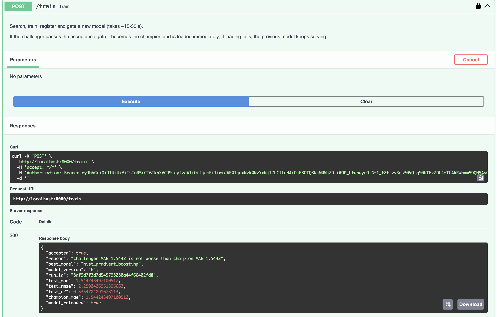
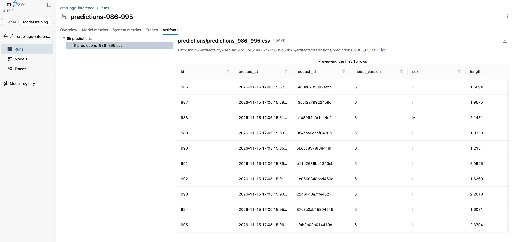
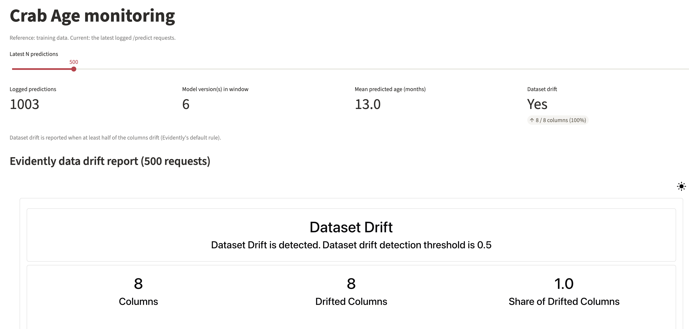
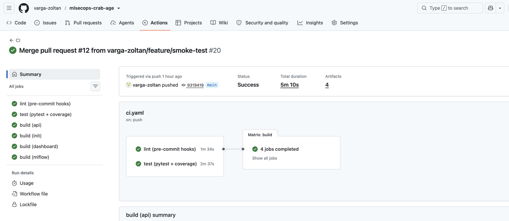
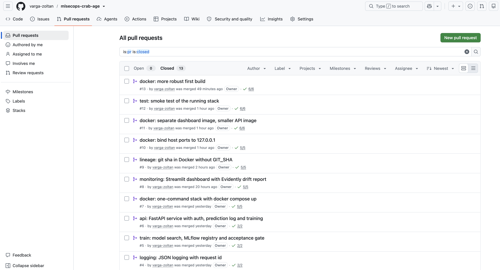

# Crab Age MLOps

MLSecOps semester project: crab age regression with an automated MLOps pipeline
(DVC, MLflow, FastAPI, Docker Compose, Evidently, Streamlit).

Work in progress. The full documentation will be added here.

## Quick start

```bash
git clone https://github.com/varga-zoltan/mlsecops-crab-age.git
cd mlsecops-crab-age
docker compose up
```

No `.env` file or secrets are needed. The first start builds the images, pulls the data
with DVC and trains the first model, so it takes a few minutes. The API starts when this is done.

| Service | URL | Notes |
|---|---|---|
| API (Swagger UI) | http://localhost:8000/docs | `/token`, `/health`, `/version`, `/train`, `/predict` |
| MLflow | http://localhost:5500 | experiments, model registry (`crab-age@champion`) |
| Monitoring dashboard | http://localhost:8501 | Streamlit + Evidently data drift report |

The ports are bound to `127.0.0.1`, so the services are reachable only from this machine,
not from other machines on the network. Postgres is only reachable from the containers.

**Login (local development only):** user `crab`, password `crab-dev-password`.
These are local defaults in `docker-compose.yaml`. For any real use, override
`CRAB_API_PASSWORD_HASH`, `CRAB_JWT_SECRET_KEY` and `POSTGRES_PASSWORD` with environment
variables or a `.env` file (see `.env.example`).

Check the running stack with the smoke test (plain Python 3.12+, nothing to install):

```bash
python3 scripts/smoke_test.py
```

It calls `/health`, `/version`, `/token`, `/train` and `/predict` (including the 401 and 422 cases)
and the MLflow and dashboard health endpoints, prints one `PASS`/`FAIL` line per check and exits
with 1 if any check fails.

Stop: `docker compose down`. Reset everything (data, models, logs): `docker compose down -v`.

## Dataset

[Crab Age Prediction](https://www.kaggle.com/datasets/sidhus/crab-age-prediction) (Kaggle, CC0).
Target: `Age` (months), regression.

## Data preprocessing

DVC stage `prepare` (`dvc repro`), code in `src/crab_age/data/`, settings in `params.yaml`.

1. Load the raw CSV and rename columns to snake_case (`Shucked Weight` → `shucked_weight`).
2. Validate the schema: all columns present, no missing values, numeric types, `sex` in M/F/I.
3. Drop physically impossible rows:

   | Rule | Rows |
   |---|---|
   | a size or weight is 0 or negative | 2 |
   | `height` > 0.8 × `diameter` (typical ratio: 0.34) | 2 |
   | `shucked_weight` > `weight` | 4 |
   | `diameter` > `length` | 1 |

   3893 rows in, 3884 rows out. The counts are written to `metrics/prepare.json`.
4. Split into a fixed train (80%) and test (20%) set with a fixed seed.
   Every model is evaluated on the same test set, so champion and challenger are comparable.

Outputs in `data/processed/` (tracked by DVC): `crab_age_clean.csv`, `train.csv`, `test.csv`.

Scaling and encoding are not done here. They are part of the sklearn `Pipeline`,
so training and serving use the same transformations.

## Monitoring and drift report

Every `/predict` request and its prediction is logged in the Postgres database `monitoring`.
The dashboard (http://localhost:8501) compares the latest N logged requests (slider, default 500)
with the training data using Evidently's `DataDriftPreset`. Dataset drift is reported when at least
half of the feature columns drift (Evidently's default rule).

Right after the first start the log is empty, so the dashboard asks for data. Generate traffic
inside the running stack (no local Python needed):

```bash
docker compose exec api python -m crab_age.monitoring.simulate_traffic --mode normal --n 500
docker compose exec api python -m crab_age.monitoring.simulate_traffic --mode drift --n 500
```

`normal` sends real crabs from the held-out test set (expected: no dataset drift),
`drift` sends the same crabs bigger and heavier, with more juveniles (expected: dataset drift).
With the project venv active, the same works from the host: `python scripts/simulate_traffic.py --mode drift`.

Evidently and Streamlit usage telemetry is switched off (`DO_NOT_TRACK=1`, `--browser.gatherUsageStats=false`).

## Screenshots

Taken on a fresh clone after `docker compose down -v` and `docker compose up`.

### Docker and smoke test

All services healthy, host ports bound to `127.0.0.1`:


`python3 scripts/smoke_test.py` against the running stack:


### REST API (Swagger UI)

`POST /train`: search, training and acceptance gate; the new champion is loaded at once:



`POST /predict` with a valid crab:


Invalid input (`sex: "X"`) is rejected with 422:


Without a token the API answers 401:


### MLflow

Training runs: one parent run per training with a nested run per model type, test metrics and
the gate decision. Versions 3 and 4 come from a challenger limited to Ridge (worse MAE), so the
gate rejected them:


Model registry: the `champion` alias and the `gate` tag of every version:


Logged predictions exported to the `crab-age-inference` experiment as CSV artifacts:



### Monitoring dashboard (Streamlit + Evidently)

After 500 requests with real held-out crabs (`--mode normal`): no dataset drift:


After 500 drifted requests (`--mode drift`): dataset drift detected:



Drift per column:


### GitHub

CI on `main`: lint, tests with coverage and the four Docker image builds:



Merged pull requests (feature branches, merge commits):



## Technical decisions

- The model is saved in MLflow's sklearn format with `skops`, not `pickle`. Loading a pickle file
  runs any code that is in it, so a tampered model file would be code execution on the API server.
  skops only loads an allow-list of types; the two tree types the models need are listed in
  `SKOPS_TRUSTED_TYPES` (`src/crab_age/model/train.py`). The model is also saved with a signature.
- MLflow stores artifacts on a Docker volume, not in MinIO: the official MinIO image is no longer
  published and the third-party rebuild is not maintained, which is a supply chain risk.

## Assignment

See [docs/assignment.md](docs/assignment.md).
