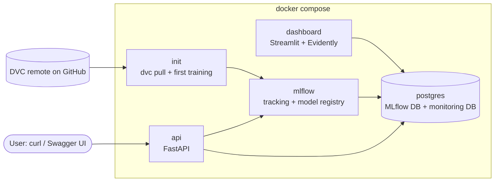
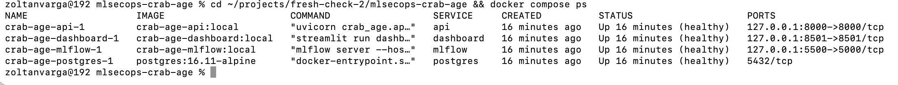
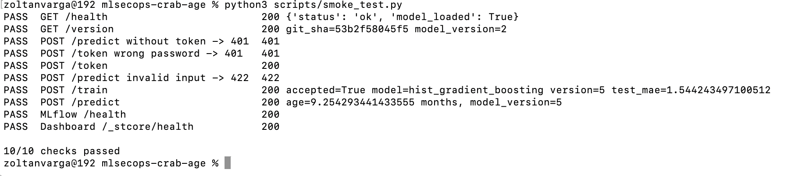
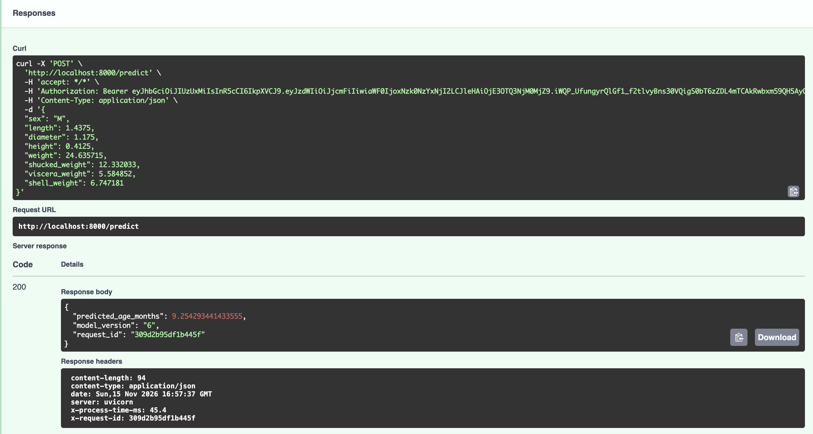
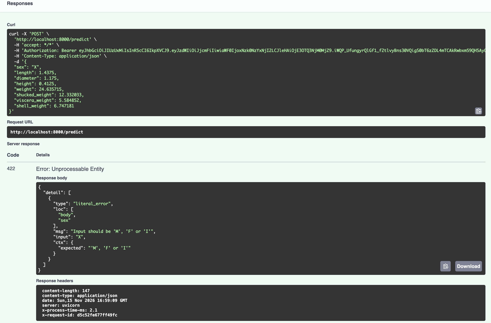
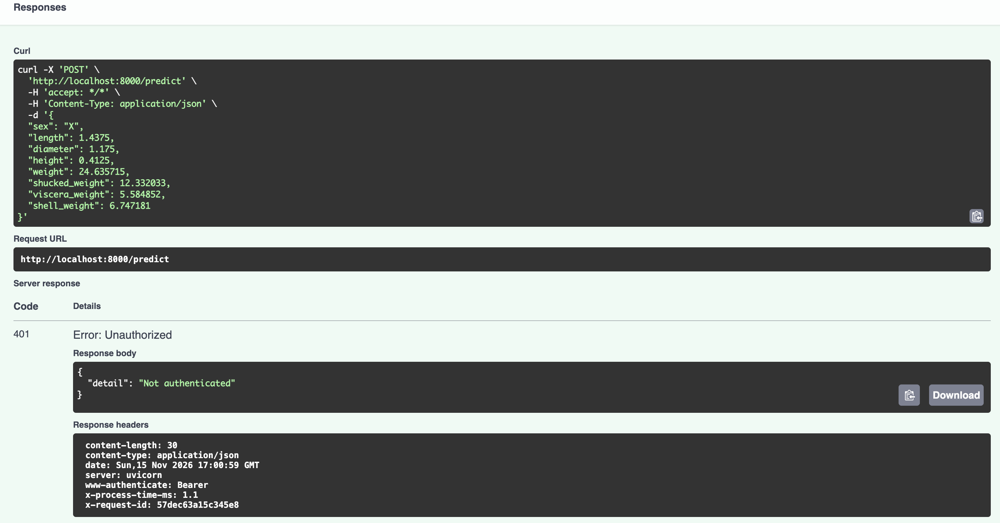
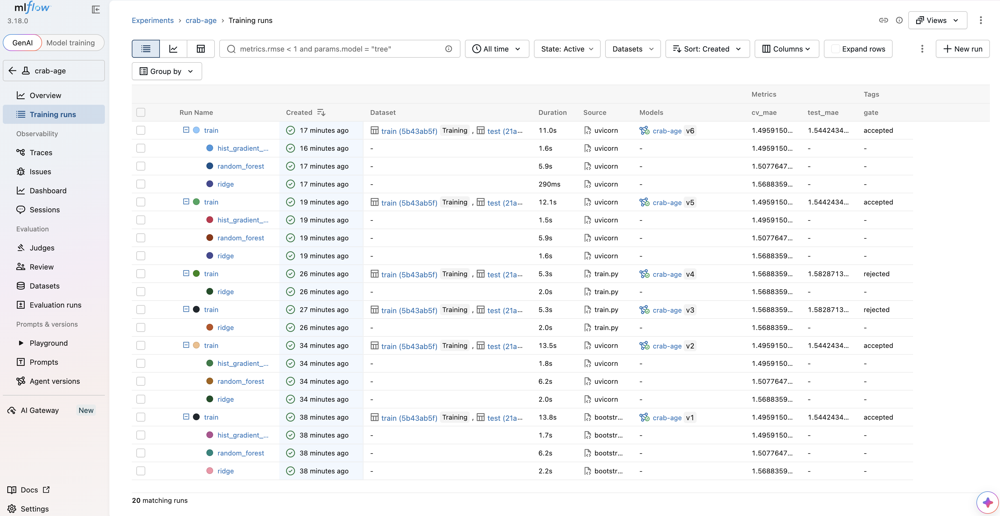
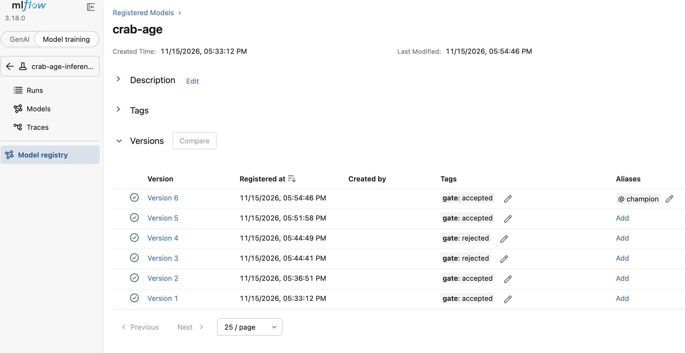
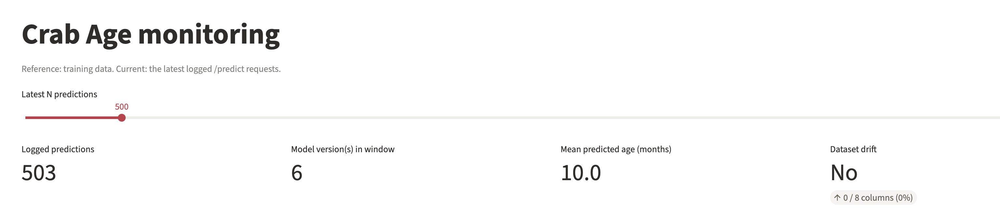
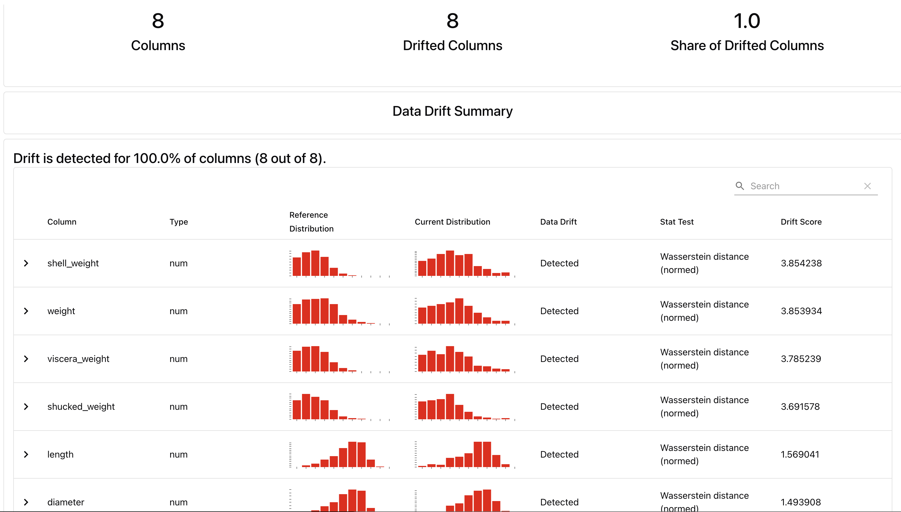

# Crab Age MLOps

MLSecOps semester project: predicting the age of a crab (in months) from its measurements,
with an automated MLOps pipeline around the model.

- **Data:** versioned with DVC, pulled from a public GitHub remote.
- **Training:** several model types with hyperparameter search; the best one is the challenger.
- **Acceptance gate:** the challenger replaces the champion only if it is not worse. A worse
  model never goes live.
- **Serving:** FastAPI with JWT authentication; every request and prediction is logged.
- **Monitoring:** Streamlit dashboard with an Evidently data drift report.
- **One command:** `docker compose up` starts everything, including the first training.

## Architecture



Arrows show who connects to whom. The shared volumes (pulled data, MLflow artifacts) are not drawn.

| Service | Role |
|---|---|
| `postgres` | MLflow backend store, plus a separate `monitoring` database for the prediction log |
| `mlflow` | Tracking server and model registry (`ghcr.io/mlflow/mlflow:v3.18.0`); artifacts on a volume |
| `init` | One-shot job: `dvc pull` into a shared data volume, then a first training if there is no `champion` yet; exits |
| `api` | FastAPI: `/token`, `/health`, `/version`, `/train`, `/predict` |
| `dashboard` | Streamlit + Evidently: training data (from the data volume) vs. logged requests (from Postgres) |

Start order is enforced with healthchecks and `depends_on` conditions: postgres → mlflow →
init (must exit with 0) → api and dashboard.

## Quick start

```bash
git clone https://github.com/varga-zoltan/mlsecops-crab-age.git
cd mlsecops-crab-age
docker compose up
```

No `.env` file or secrets are needed. The first start builds the images, pulls the data
with DVC and trains the first model, so it takes a few minutes. The API starts when this is done.

| Service | URL | Notes |
|---|---|---|
| API (Swagger UI) | http://localhost:8000/docs | `/token`, `/health`, `/version`, `/train`, `/predict` |
| MLflow | http://localhost:5500 | experiments, model registry (`crab-age@champion`) |
| Monitoring dashboard | http://localhost:8501 | Streamlit + Evidently data drift report |

The ports are bound to `127.0.0.1`, so the services are reachable only from this machine,
not from other machines on the network. Postgres is only reachable from the containers.

**Login (local development only):** user `crab`, password `crab-dev-password`.
These are local defaults in `docker-compose.yaml`. For any real use, override
`CRAB_API_PASSWORD_HASH`, `CRAB_JWT_SECRET_KEY` and `POSTGRES_PASSWORD` with environment
variables or a `.env` file (see `.env.example`).

Check the running stack with the smoke test (plain Python 3.12+, nothing to install):

```bash
python3 scripts/smoke_test.py
```

It calls `/health`, `/version`, `/token`, `/train` and `/predict` (including the 401 and 422 cases)
and the MLflow and dashboard health endpoints, prints one `PASS`/`FAIL` line per check and exits
with 1 if any check fails.

Stop: `docker compose down`. Reset everything (data, models, logs): `docker compose down -v`.
After changing the code, rebuild the images: `docker compose up --build`.

## Using the API

Get a token (valid for 30 minutes):

```bash
TOKEN=$(curl -s -X POST http://localhost:8000/token \
  -d 'username=crab&password=crab-dev-password' \
  | python3 -c 'import json,sys; print(json.load(sys.stdin)["access_token"])')
```

Predict the age of one crab:

```bash
curl -s -X POST http://localhost:8000/predict \
  -H "Authorization: Bearer $TOKEN" -H 'Content-Type: application/json' \
  -d '{"sex": "F", "length": 1.4375, "diameter": 1.175, "height": 0.4125, "weight": 24.635715,
       "shucked_weight": 12.332033, "viscera_weight": 5.584852, "shell_weight": 6.747181}'
```

```json
{"predicted_age_months": 9.25, "model_version": "6", "request_id": "75f293da29dc4fa4"}
```

Train a new challenger (search + gate, takes 15-30 s):

```bash
curl -s -X POST http://localhost:8000/train -H "Authorization: Bearer $TOKEN"
```

```json
{"accepted": true, "reason": "challenger MAE 1.5442 is not worse than champion MAE 1.5442",
 "best_model": "hist_gradient_boosting", "model_version": "6", "test_mae": 1.544, "model_reloaded": true}
```

Info endpoints without login: `curl http://localhost:8000/health`, `curl http://localhost:8000/version`
(API version, git commit, served model version).

| Request | Answer |
|---|---|
| No or invalid token on `/train` or `/predict` | 401 |
| Wrong type, size <= 0, size above the limit, unknown `sex`, missing or extra field | 422 |
| Request body over 4 KB | 413 |
| `/train` while another training runs | 409 |
| `/predict` without a champion model | 503 |

Every response has an `X-Request-ID` header; the same id is in every JSON log line of that request.

## Training and the acceptance gate

Code in `src/crab_age/model/`, settings in `params.yaml` (`train:`).

1. **Search:** Ridge, RandomForest and HistGradientBoosting, each with `RandomizedSearchCV`
   (5-fold CV) over the search space in `params.yaml`. Preprocessing (one-hot encoding of `sex`,
   scaling) is part of the sklearn `Pipeline`.
2. **Challenger:** the candidate with the lowest CV MAE. It is evaluated on the fixed test set
   (MAE, RMSE, R²).
3. **Acceptance gate:** the challenger gets the `champion` alias only if its test MAE is
   **not worse than the current champion's** (re-evaluated on the same test set) **and not above 2.0**.
   Otherwise the old champion stays and the version gets the tag `gate: rejected`.
4. **Exit code:** `python -m crab_age.train` exits with 0 (new champion) or 1 (rejected).

MLflow (experiment `crab-age`) gets one parent run per training with a nested run per model type,
the parameters, metrics, the datasets, the tags `git_sha`, `dvc_data_hash`, `dvc_raw_hash` and `gate`,
and the model with its signature. The same training runs in the `init` container on the first
start and on every `POST /train`.

Every logged prediction is also exported to the MLflow experiment `crab-age-inference` as a
CSV artifact, in batches of 10 (`CRAB_INFERENCE_BATCH_SIZE`).

## Dataset

[Crab Age Prediction](https://www.kaggle.com/datasets/sidhus/crab-age-prediction) (Kaggle, CC0).
Target: `Age` (months), regression.

The data is tracked with DVC. The default remote is the public repository
[mlsecops-crab-age-data](https://github.com/varga-zoltan/mlsecops-crab-age-data), read over HTTP,
so `dvc pull` works without credentials.

## Data preprocessing

DVC stage `prepare` (`dvc repro`), code in `src/crab_age/data/`, settings in `params.yaml`.

1. Load the raw CSV and rename columns to snake_case (`Shucked Weight` → `shucked_weight`).
2. Validate the schema: all columns present, no missing values, numeric types, `sex` in M/F/I.
3. Drop physically impossible rows:

   | Rule | Rows |
   |---|---|
   | a size or weight is 0 or negative | 2 |
   | `height` > 0.8 × `diameter` (typical ratio: 0.34) | 2 |
   | `shucked_weight` > `weight` | 4 |
   | `diameter` > `length` | 1 |

   3893 rows in, 3884 rows out. The counts are written to `metrics/prepare.json`.
4. Split into a fixed train (80%) and test (20%) set with a fixed seed.
   Every model is evaluated on the same test set, so champion and challenger are comparable.

Outputs in `data/processed/` (tracked by DVC): `crab_age_clean.csv`, `train.csv`, `test.csv`.

Scaling and encoding are not done here. They are part of the sklearn `Pipeline`,
so training and serving use the same transformations.

## Monitoring and drift report

Every `/predict` request and its prediction is logged in the Postgres database `monitoring`.
The dashboard (http://localhost:8501) compares the latest N logged requests (slider, default 500)
with the training data using Evidently's `DataDriftPreset`. Dataset drift is reported when at least
half of the feature columns drift (Evidently's default rule).

Right after the first start the log is empty, so the dashboard asks for data. Generate traffic
inside the running stack (no local Python needed):

```bash
docker compose exec api python -m crab_age.monitoring.simulate_traffic --mode normal --n 500
docker compose exec api python -m crab_age.monitoring.simulate_traffic --mode drift --n 500
```

`normal` sends real crabs from the held-out test set (expected: no dataset drift),
`drift` sends the same crabs bigger and heavier, with more juveniles (expected: dataset drift).
With the project venv active, the same works from the host: `python scripts/simulate_traffic.py --mode drift`.

Evidently and Streamlit usage telemetry is switched off (`DO_NOT_TRACK=1`, `--browser.gatherUsageStats=false`).

## Development

Python 3.12. Local setup:

```bash
python3.12 -m venv .venv
source .venv/bin/activate
pip install -r requirements_dev.txt
pip install --no-deps -e .
pre-commit install
dvc pull
```

Tests and quality checks (the same run in GitHub Actions):

```bash
flake8                                    # PEP8, max line length 120
pyright                                   # strict type check of src/
coverage run -m pytest                    # unit, API, property-based (Hypothesis) and dashboard tests
coverage report -m --fail-under=95        # coverage of src/ and tests/
pre-commit run --all-files                # file checks, gitleaks, flake8, pyright
```

The tests need no running services: MLflow uses a temporary SQLite store, the prediction log
SQLite, the API FastAPI's `TestClient`, and HTTP calls are mocked. Current state: 243 tests,
100% coverage, 0 flake8 and 0 pyright errors.

| Tool | Where |
|---|---|
| pre-commit | `.pre-commit-config.yaml`: large files, merge conflicts, YAML/JSON, whitespace, private keys, gitleaks, nbstripout, flake8, pyright |
| GitHub Actions | `.github/workflows/ci.yaml`: lint, tests + coverage (min. 95%), Docker build of the four images; push to GHCR on `main` |
| Branch protection | `main` only by pull request with a merge commit; all six CI checks must pass |
| Dependencies | exact versions (`==`) in `requirements.txt`, `requirements_dashboard.txt`, `requirements_dev.txt` |

Git workflow: short-lived `feature/<topic>` branches, one pull request each, merge commits
(no squash, no rebase), commits signed off with `git commit -s`.

More details on the decisions: [docs/progress.md](docs/progress.md).

## Screenshots

Taken on a fresh clone after `docker compose down -v` and `docker compose up`.

### Docker and smoke test

All services healthy, host ports bound to `127.0.0.1`:



`python3 scripts/smoke_test.py` against the running stack:



### REST API (Swagger UI)

`POST /train`: search, training and acceptance gate; the new champion is loaded at once:


`POST /predict` with a valid crab:



Invalid input (`sex: "X"`) is rejected with 422:



Without a token the API answers 401:



### MLflow

Training runs: one parent run per training with a nested run per model type, test metrics and
the gate decision. Versions 3 and 4 come from a challenger limited to Ridge (worse MAE), so the
gate rejected them:



Model registry: the `champion` alias and the `gate` tag of every version:



Logged predictions exported to the `crab-age-inference` experiment as CSV artifacts:


### Monitoring dashboard (Streamlit + Evidently)

After 500 requests with real held-out crabs (`--mode normal`): no dataset drift:



After 500 drifted requests (`--mode drift`): dataset drift detected:


Drift per column:



### GitHub

CI on `main`: lint, tests with coverage and the four Docker image builds:


Merged pull requests (feature branches, merge commits):


## Technical decisions

- The model is saved in MLflow's sklearn format with `skops`, not `pickle`. Loading a pickle file
  runs any code that is in it, so a tampered model file would be code execution on the API server.
  skops only loads an allow-list of types; the two tree types the models need are listed in
  `SKOPS_TRUSTED_TYPES` (`src/crab_age/model/train.py`). The model is also saved with a signature.
- MLflow stores artifacts on a Docker volume, not in MinIO: the official MinIO image is no longer
  published and the third-party rebuild is not maintained, which is a supply chain risk.
- Secrets have no default in the Python code. The development defaults live only in
  `docker-compose.yaml`, so that `docker compose up` works without any setup; they must be
  overridden outside local development.
- The password is stored only as an Argon2 hash; the JWT key must be at least 64 bytes (HS512).
- Inputs are validated strictly (types, ranges, no extra fields) before they reach the model.
- The git commit of every model (`git_sha` tag) is read from the repository's `.git` folder,
  mounted read-only into the containers, so lineage works with a plain `docker compose up`.

## Known limitations

- The login and the database password are public development defaults. This is a deliberate
  trade-off for a one-command start; they are not meant for real use.
- There is only one API user and no roles.
- `POST /train` is synchronous: the request waits 15-30 s for the training.
- Inside Docker the `git_sha` tag cannot show uncommitted changes (`-dirty`), because there is
  no git program in the images.
- The images are large (API 1.3 GB, dashboard 1.7 GB), mostly because of MLflow, scikit-learn and
  Evidently. `mlflow-skinny` was evaluated and not used (see `docs/progress.md`).
- Harmless warnings in the logs: a `duplicate key` message from MLflow's own Postgres inserts,
  an integer schema hint and a `psutil` version note when the model is loaded.
- No scheduled retraining (Airflow, optional part of the assignment) was built.

## AI usage

I used two AI tools for this project:

- **Claude (claude.ai chat)** wrote the first version of `CLAUDE.md`, the instruction file for the
  coding assistant, based on the assignment text. I gave the requirements and changed it in
  several places.
- **Claude Code** (Anthropic, in the Claude desktop app) was the coding assistant for the whole
  implementation: Python code, tests, Dockerfiles, `docker-compose.yaml`, the CI workflow and most
  of this documentation. It also prepared the options and their risks before decisions,
  investigated errors, and ran the checks (flake8, pyright, pytest, coverage, the stack in Docker,
  the smoke test).

How the work was divided:

- I set the goals and the requirements, and I made the decisions. Usually I chose from the options
  and recommendations the AI prepared; in some cases I decided differently. Examples: MLflow 3.18
  with the same version for the client and the server, a separate database for the prediction log,
  building the MLflow inference batches from that database, the separate dashboard image, extra
  test cases for the git lineage, leaving out Airflow.
- The AI was not allowed to run git commands that change the repository. It gave me the exact
  commands, and I ran every commit, push, pull request and merge myself.
- I checked the results before merging: the test and CI results, the running system after
  `docker compose up`, and two checks from a fresh clone. I took the screenshots myself.

The AI made mistakes that the checks caught, for example: a first version of the traffic
simulator caused false drift, the first JWT key length was too short for HS512 (PyJWT warned about
it), and packages were once installed into the system Python instead of the project environment.
Small steps, automatic checks and a running system after every step were what made the AI output
usable.

## Assignment

See [docs/assignment.md](docs/assignment.md).
